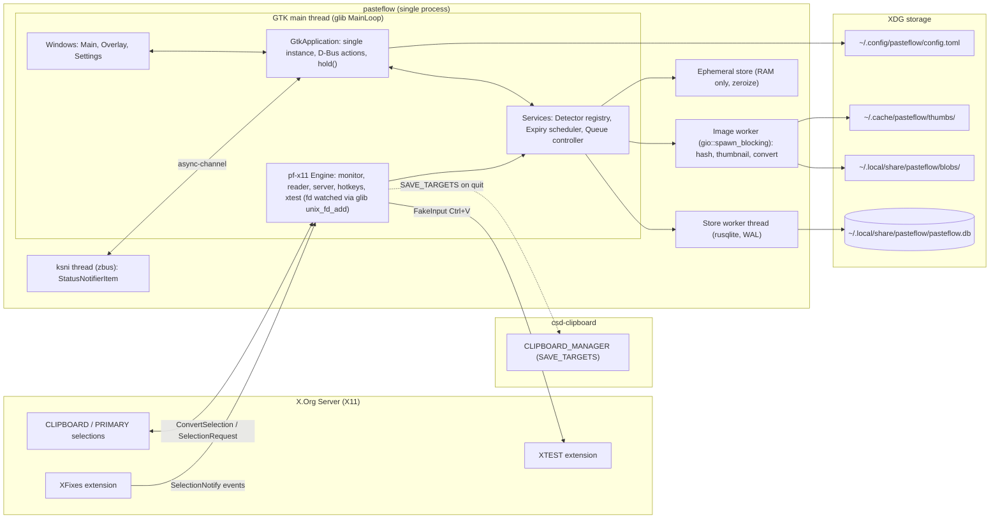
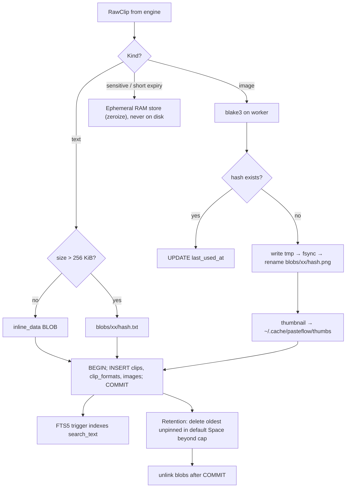
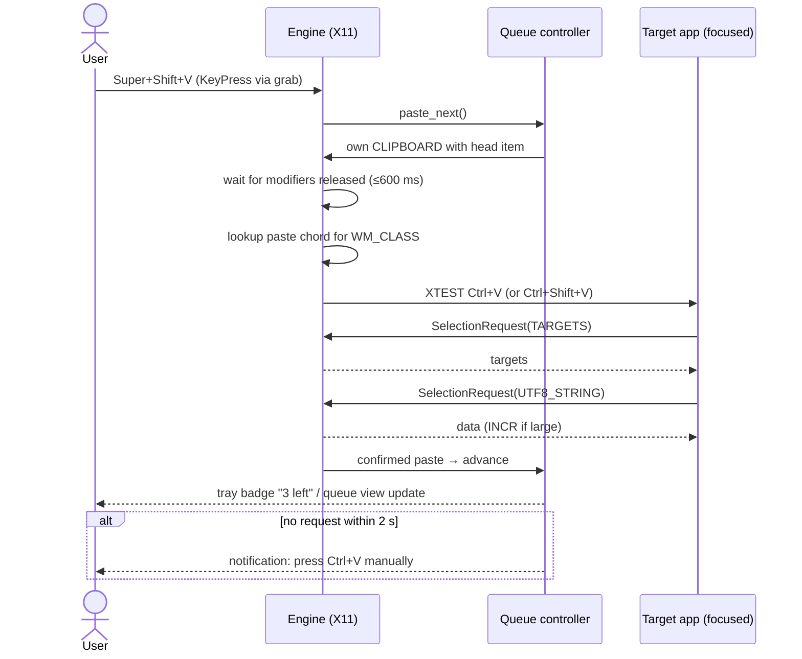

# PasteFlow — Technical Planning Document

*Working name: **PasteFlow**, taken from the workspace folder `/home/unss/Pasteflow`. This is a native Linux clipboard manager that takes Pastily as its functional reference. It does not use Pastily's branding or assets.*

Research date: 2026-11-23. Every environment fact marked ✅ was **checked on your machine**. Every crate version was **read from the crates.io API** today.

---

## ✅ Decisions (approved 2026-11-23)

| Q | Decision |
|---|---|
| Q1 Shortcuts | **Super+V** (overlay), **Super+Shift+V** (paste next); Pastily preset available in Settings |
| Q2 Toolkit | **Plain GTK4**, no libadwaita |
| Q3 Sensitive / ≤1 h clips | **Memory-only**, never written to disk |
| Q4 Spaces | **One Space per clip**; type collections are virtual filters |
| Q5 GPU | Runs **without the NVIDIA driver** (llvmpipe) → cairo renderer is the expected default, still measured in M0 |
| Q6 Repo | Separate repo `https://github.com/unsshub/Pasteflow.git`, project directory **`/home/unss/PasteFlow`** |

## User Review Required

> [!IMPORTANT]
> **Facts found on your system that affect the design**
> 1. ✅ **CopyQ is running** (autostart, global keys Ctrl+Shift+S / Ctrl+Shift+X). Two clipboard managers can fight over ownership and shortcuts. CopyQ must be quit while PasteFlow is tested and disabled once PasteFlow replaces it.
> 2. ✅ **`csd-clipboard`** (Cinnamon settings daemon) owns the `CLIPBOARD_MANAGER` selection. It keeps clipboard contents available after the copying app exits. PasteFlow will **cooperate with it, not replace it**.
> 3. ✅ **OpenGL runs on `llvmpipe` (software rendering)** because no NVIDIA or nouveau kernel module is loaded. GTK4's default GL renderer would therefore use CPU. The plan sets the GTK renderer explicitly; the choice gets measured in M0.
> 4. ✅ **Bitwarden** starts automatically. Its window class goes into the default capture exclusions from day one.
> 5. ✅ **Rust is not installed.** M0 installs it with `rustup` (user-level, no root).
> 6. ✅ `/home/unss` is itself a git repository and `Pasteflow/` is an empty folder inside it. PasteFlow would live in that monorepo unless you prefer a separate repo.

> [!WARNING]
> **What cannot be done reliably on Linux (stated honestly)**
> - **Forensic-grade secure deletion** cannot be guaranteed on ext4/SSD (journaling, wear-levelling, TRIM, snapshots). The plan handles this by **never writing sensitive clips to disk** (§17).
> - **Wayland**: background clipboard monitoring, global key grabs, synthetic paste and window positioning **do not work the X11 way**. On this machine, Cinnamon's portal backends offer no GlobalShortcuts or RemoteDesktop portal (✅ verified). Wayland is a separate, reduced-capability target (§9).
> - **Excluding specific applications** is **best-effort** on X11. The window that owns the clipboard is often a hidden helper window. One test showed a PID (`_NET_WM_PID`) but **no `WM_CLASS`** (✅ verified).
> - **Synthetic Ctrl+V** works for most X11 apps, but terminals use Ctrl+Shift+V and some apps (VMs, remote-desktop clients) capture the keyboard. A per-app paste-key table and a manual-paste fallback are part of the design.

## Open Questions

> [!IMPORTANT]
> **Q1 — Default global shortcuts.** Pastily uses **Ctrl+Shift+B** (open) and **Ctrl+Shift+V** (paste next). On your system, **Ctrl+Shift+V is paste in gnome-terminal** and "paste without formatting" in Chrome and LibreOffice. **Ctrl+Shift+B** toggles the bookmarks bar in Chrome and Firefox. Grabbing these globally breaks those actions everywhere.
> **Recommendation:** default to **Super+V** (open overlay) and **Super+Shift+V** (paste next). Both are free in your Cinnamon bindings (✅ verified). Settings would offer a one-click "Pastily-compatible" preset. Do you agree?

> [!IMPORTANT]
> **Q2 — libadwaita or plain GTK4?** libadwaita looks polished, but it **forces the GNOME Adwaita style and ignores your Mint-Y-Dark-Orange theme**. Plain GTK4 picks up the Mint-Y GTK4 theme automatically (✅ the `gtk-4.0` theme folders exist).
> **Recommendation:** plain GTK4 plus a small custom stylesheet, so the app looks native in Mint. The cost is roughly 10–15% more UI code for preferences and toasts.

> [!IMPORTANT]
> **Q3 — Sensitive and short-lived clips are memory-only.** Clips flagged sensitive, or with expiry ≤ 1 h, would **never touch disk**. As a result they **do not survive an app restart or reboot**. This is the only honest way to keep the "wiped from disk" promise. Acceptable?

> [!NOTE]
> **Q4 — Space membership.** Recommendation: **each clip belongs to exactly one Space**, as in Pastily ("move a clip to a Space"). Automatic **type collections** (Text, Code, Links, Colors, Images…) are virtual filters, not memberships. Confirm, or do you need one clip in several Spaces?
>
> **Q5 — GPU.** Is running without the NVIDIA driver intentional? (The GT 710 needs the legacy 470 driver.) The plan works either way; this only changes which GTK renderer is used.
>
> **Q6 — Identity.** Proposed app ID `app.pasteflow.PasteFlow`, binary `pasteflow`. Keep it in the `/home/unss` monorepo or use a separate repo?

---

## 1. Executive Summary

PasteFlow is a **single-process, native GTK4 application written in Rust**. It watches the X11 clipboard through **XFixes selection-owner notifications**: no polling, and no wakeups while idle. Text, rich text, images and file lists are stored in a local **SQLite (WAL) database with an FTS5 trigram index**. Image originals live as **content-addressed files** referenced from the database, and thumbnails go in the XDG cache. The application stays resident **with no windows open** (GtkApplication `hold()`), shows a **StatusNotifierItem tray icon** (Cinnamon's xapp applet supports it), and opens a **floating overlay** from a global shortcut.

The **clipboard engine talks to the X protocol directly through `x11rb`** and handles everything in one place: monitoring, reading, serving data back to apps, global key grabs and XTEST paste. This keeps behaviour predictable for large transfers (INCR protocol), password-manager hints, owner identification and the Universal Paste Queue. GTK is used only for the interface.

Priorities follow your list: a reliable clipboard engine and persistence come first (M0–M1), polish last. The paste queue uses **XTEST key synthesis on X11**. Wherever synthesis is impossible (Wayland, apps that capture the keyboard), it falls back to "load next item and let the user press Ctrl+V".

---

## 2. Functional Requirements

| ID | Module | Requirement (condensed) | Priority | Difficulty |
|---|---|---|---|---|
| A1–A16 | Capture & history | XFixes monitoring; text, image, file, HTML capture; persistence; 2,000 default cap (configurable); delete, clear, pin; duplicate collapse; timestamps; previews; copy back | P0 | Medium–Hard (ICCCM details) |
| A-PRI | PRIMARY | Optional capture of the PRIMARY selection, **off by default**, debounced | P2 | Medium |
| B | Recognition | text, code (language guess + highlighting), URL, color (HEX/RGB/HSL + conversions), email, phone, number, image, files, *secret* | P1 | Easy–Medium (language guess is heuristic) |
| C | Spaces | CRUD, color, icon, move clips, drag-and-drop, default Space, instant switching, 5 seeded Spaces | P1 | Easy–Medium |
| D | Paste Queue | add, remove, reorder, list, paste next, remaining count, clear, keyboard control, "Universal Paste" auto-collect mode | P1 | **Hard** (input synthesis) |
| E | Expiry & privacy | per-clip timers (15 s … 24 h, custom), countdown, auto-delete, pinned protection, sensitive flag, exclusions, pause capture | P1 | Medium |
| F | Images | capture, files on disk, thumbnails, dimensions and size, copy again, save to disk, open in viewer, delete | P1 | Medium |
| G | Search | instant FTS, filter by type, Space, pinned and date; search titles, code, URLs, image metadata | P0 | Easy–Medium |
| H | Shortcuts | global (open, paste next), in-app (Esc, arrows, Enter, Del, Ctrl+F, Ctrl+P …), customizable, conflict detection | P0 | Medium |
| I | Desktop | tray, background running, autostart, close/minimize to tray, notifications, desktop entry, icon, graceful shutdown | P0 | Easy–Medium |

**Out of scope, or deferred deliberately:** Pastily's "Notch Island" (macOS hardware), stickers/tape decorations (cosmetic, possibly later), licence and auto-update, cloud sync (excluded by requirement), and URL title/favicon fetching (would need the network, which is forbidden).

## 3. Non-Functional Requirements

| Area | Requirement |
|---|---|
| Reliability | No missed copies under normal use. Copies arriving faster than the source app can answer may merge (documented). Survives source-app exit, PasteFlow restart and reboot. |
| Resources | Zero periodic wakeups while idle. Background memory and CPU within the budgets in §18. No GPU requirement (works on llvmpipe). |
| Startup | Tray-ready in < 300 ms (target, measured in M0). Overlay visible < 100 ms after the hotkey (warm). |
| Offline/Privacy | No network code at all. Crates are audited for HTTP clients (`cargo tree` check in CI). No telemetry. Logs never contain clipboard content. |
| Portability | Linux Mint 22.x Cinnamon on X11 is the main target. Wayland is a documented, reduced-feature target. |
| Maintainability | Rust workspace with the clipboard engine, storage and UI in separate crates. The engine and storage are testable without a display (or with Xvfb). |
| Data safety | WAL plus `synchronous=NORMAL`, integrity check at start, automatic backup rotation, corruption recovery path. |

## 4. Feature Comparison with Pastily

Source: pastily.app home page, `/docs` and `/changelog` (v1.0 → v2.2), fetched 2026-11-23.

| Pastily feature (verified on its site) | PasteFlow plan | Notes |
|---|---|---|
| Text/link/code/image history, local SQLite, up to 2,000 clips | ✅ Same; cap configurable | Pinned clips and clips moved to a Space don't count toward the cap |
| "Sub-1 ms search" | ✅ FTS5 trigram | We don't claim a number until it is measured (§18) |
| Smart classification: text, code, links, emails, phones, numbers | ✅ Plus colors, files and *secret* | Modular detector registry |
| Color swatches with HEX/RGB/HSL conversion | ✅ | Conversion code written in-house (no extra library) |
| Images: raw capture, 1-click save to Downloads with a toast | ✅ Plus "open in viewer" | Uses an XDG portal or `gio::AppInfo` default handler |
| Auto-disappear timers 15 s/30 s/1 m/5 m/15 m/1 h/24 h/custom, live countdown, "wiped from RAM and disk" | ✅ Same presets | Honest scope: **memory-only storage** for sensitive clips, best-effort RAM wiping (§17) |
| Universal Paste Queue: while on, every copy joins the queue; each Ctrl+Shift+V press pastes the next in FIFO order; shortcut rebindable | ✅ X11 via XTEST | Manual-paste fallback when synthesis isn't possible. Default key: see Q1 |
| Spaces: auto type Spaces (Text, Links, Code, Images, Colors) plus custom color-coded Spaces, pins, "Saved" | ✅ Type collections as filters plus user Spaces | Pastily's "Saved" = our "clip in a non-default Space" |
| Global hotkey Ctrl+Shift+B, rebindable | ✅ Rebindable | Default: see Q1 |
| Menu-bar control panel | ✅ Tray menu (SNI) | Cinnamon xapp-status-applet |
| Stickers (pins/magnets/tape), Notch Island, licence, auto-updates | ❌ / later | Not functional requirements on Linux |
| — | ➕ PRIMARY selection (optional), app exclusions, pause capture, password-manager hint, file-list clips, export/import | Linux-specific additions |

---

## 5. Recommended Technology Stack

### 5.1 Framework comparison

| Criterion | **Rust + GTK4** | Rust + GTK4 + libadwaita | Rust + Tauri | Python + GTK4 | Electron |
|---|---|---|---|---|---|
| Mint 22 compatibility | ✅ GTK 4.14 from apt | ✅ libadwaita 1.5 from apt | ⚠️ WebKitGTK 4.1 | ✅ | ✅ |
| Idle memory (expected order of magnitude, to be measured) | Low (tens of MB) | Low (+ a few MB) | Medium (WebKit processes) | Medium (CPython + GI) | High (Chromium, 100 MB+) |
| Clipboard protocol control | Full (x11rb alongside GTK) | Full | Via a Rust plugin, but the UI is web-based | python-xlib possible, slower | Electron clipboard API: **no change events** → polling |
| Global shortcuts | Own key grab (XGrabKey) | same | `global-shortcut` plugin (X11 grab) | python-xlib | `globalShortcut` (X11 grab) |
| Tray | ksni (pure D-Bus) | same | libappindicator (GTK3) | AppIndicator (GTK3) | built-in |
| Native look in Mint | ✅ follows Mint-Y theme | ⚠️ Adwaita look, ignores Mint-Y | ❌ web UI (also against your rules) | ✅ | ❌ |
| GPU independence | ✅ cairo renderer option | ✅ | ⚠️ WebKit compositing on llvmpipe costs CPU | ✅ | ⚠️ |
| Long-term maintenance | Good (gtk-rs is active: gtk4 0.11.5, Sep 2026) | Good | Good | Good | Heavy |
| Complexity | Medium–High (GTK object model in Rust) | Medium | Medium | Low–Medium | Low |

**Decision: Rust + GTK4 (`gtk4` crate with feature `v4_14`), without libadwaita by default (see Q2).** This fits your preference, is lightest at idle, looks native in Mint, and gives direct control over the clipboard protocol. Tauri and Electron are rejected: their UI is a web view (forbidden by your rules), they cost more memory, and their clipboard APIs give no change notifications. Python is rejected for memory use and long-term robustness.

### 5.2 Clipboard monitoring options

| Option | Change detection | Large data (INCR) | Targets/hints/owner info | Verdict |
|---|---|---|---|---|
| `xclip` / `xsel` (shell out) | none → **polling** with process spawns | yes | limited | ❌ wasteful, racy |
| `arboard` 3.7 | none → polling | yes | no owner info, limited targets | ❌ meant for one-off copy/paste |
| `x11-clipboard` 0.9.3 | XFixes wait | yes | narrow API, last release Oct 2024 | ⚠️ good reference, too narrow |
| GTK4 `GdkClipboard` | `changed` signal (GDK X11 uses XFixes internally) | yes | **no owner window, no hidden-target access, no size abort** | ⚠️ fine for writing, weak for monitoring |
| `wl-clipboard-rs` 0.9.5 | Wayland data-control protocols only | yes | — | ⏭ future Wayland backend |
| **`x11rb` 0.14 (`xfixes`, `xtest` features)** | **XFixes `SelectionNotify` events, fully event-driven** | implemented ourselves per ICCCM | **full**: TARGETS, `x-kde-passwordManagerHint`, owner window → PID, timestamps, abort above size limits | ✅ **chosen** |

**Coherence rule:** one X11 connection owned by the engine handles **monitoring + reading + serving (writing) + key grabs + XTEST**. GTK never touches the clipboard. Benefits:
- **Self-detection is trivial**: if the clipboard owner is our own hidden window, the event is ignored.
- The paste queue can **watch real paste requests** (`SelectionRequest`) to confirm that a paste happened.
- One state machine covers INCR in both directions.

### 5.3 Final stack (crates verified on crates.io, 2026-11-23)

| Purpose | Crate / library | Version seen | Why |
|---|---|---|---|
| UI toolkit | [`gtk4`](https://crates.io/crates/gtk4) (needs Rust ≥ 1.92) + system GTK 4.14.5 | 0.11.5 | Native UI; `v4_14` feature matches Noble |
| X11 surface access | [`gdk4-x11`](https://crates.io/crates/gdk4-x11) | 0.11.5 | Get a window's X ID (XID) to position the overlay and set the user timestamp |
| GLib/GIO | [`glib`](https://crates.io/crates/glib), `gio` (re-exported) | 0.22.11 | Main loop, `unix_fd_add`, GApplication, GNotification |
| X11 protocol | [`x11rb`](https://crates.io/crates/x11rb) features `xfixes`,`xtest`,`xkb` | 0.14.0 | Pure-Rust X protocol, event-driven |
| Database | [`rusqlite`](https://crates.io/crates/rusqlite) feature `bundled` | 0.43.0 | Bundled SQLite gives a predictable version with FTS5, trigram and the FTS5 secure-delete option |
| Images | [`image`](https://crates.io/crates/image) (only `png`,`jpeg`,`bmp`,`webp`,`gif` features) | 0.25.10 | Decode, thumbnail, convert on request |
| Hashing | [`blake3`](https://crates.io/crates/blake3) | 1.8.7 | Fast content hashing for deduplication and blob names |
| Tray | [`ksni`](https://crates.io/crates/ksni) (feature `blocking` or `async-io`) | 0.3.7 | StatusNotifierItem over D-Bus, **no GTK3** (see note) |
| Syntax highlighting | [`sourceview5`](https://crates.io/crates/sourceview5) + system `libgtksourceview-5` 5.12 | 0.11.3 | Native widget, system style schemes, follows dark mode |
| Secrets in RAM | [`zeroize`](https://crates.io/crates/zeroize) | 1.9.2 | Wipes memory-only clip buffers on drop |
| Detection | [`regex`](https://crates.io/crates/regex), [`url`](https://crates.io/crates/url) | 1.13.2 / 2.5.9 | Detectors |
| Config | [`serde`](https://crates.io/crates/serde) + [`toml`](https://crates.io/crates/toml) | 1.0.229 / 1.2.2 | `config.toml` (no GSettings schema to install → simple AppImage and dev builds) |
| Paths | [`directories`](https://crates.io/crates/directories) | 6.0.0 | XDG base directories |
| Channels | [`async-channel`](https://crates.io/crates/async-channel) | 2.5.0 | Worker → GTK main loop messages |
| Logs | [`tracing`](https://crates.io/crates/tracing) + `tracing-subscriber` | 0.1.44 / 0.3.23 | Structured logs with redaction |
| Errors | `anyhow`, `thiserror` | 1.0.105 / 2.0.21 | — |
| **Wayland only (later)** | [`ashpd`](https://crates.io/crates/ashpd), [`wl-clipboard-rs`](https://crates.io/crates/wl-clipboard-rs) | 0.14.3 / 0.9.5 | Portals and data-control, not compiled in by default |

> [!NOTE]
> **Deliberately not used**
> - `tray-icon` (0.26.1) and libayatana-appindicator use **GTK3**, and GTK3 and GTK4 cannot run in the same process. That is why ksni is used.
> - `global-hotkey` (0.10) opens its own X connection and thread; our engine already has the X connection, and a direct key grab is about 150 lines of code.
> - `notify-rust`: GLib's `GNotification` already uses `org.freedesktop.Notifications` on Cinnamon (✅ service present).
> - `xdotool`/`libxdo`: XTEST is called directly through x11rb.
> - `syntect`: it would bundle Sublime syntax definitions (larger binary) and need conversion to Pango text attributes, while GtkSourceView is native.
> - `chrono`: `glib::DateTime` covers formatting.

---

## 6. Architecture Diagram



**Threads:** the X engine runs **on the GTK main thread** as a non-blocking state machine woken by `glib::source::unix_fd_add_local` on the x11rb socket. That means no extra thread for X, no locks, and zero wakeups when nothing happens. CPU-heavy work (hashing large data, decoding images, thumbnails) goes to `gio::spawn_blocking`. All SQLite writes go through one store-worker thread. Read queries for the UI run on a second, read-only connection, which WAL mode allows to run concurrently.

---

## 7. Clipboard Monitoring Architecture

### 7.1 How the X11 clipboard works (relevant facts)
- X11 **stores nothing**. A "selection" (CLIPBOARD, PRIMARY) is just *ownership* by a window. Data is transferred **on request**: the requestor calls `ConvertSelection(selection, target, property)`, the owner writes the data into a property and sends `SelectionNotify` (see [ICCCM §2](https://x.org/releases/X11R7.7/doc/xorg-docs/icccm/icccm.html)).
- `TARGETS` lists the formats the owner offers (e.g. `UTF8_STRING`, `text/html`, `image/png`, `x-special/gnome-copied-files`).
- Data larger than the server's maximum request size uses **INCR**: the owner sends it in chunks, each confirmed by deleting a property.
- **When the owner exits, the data is gone**, unless a clipboard manager saved it first. Apps that support the [freedesktop ClipboardManager spec](https://www.freedesktop.org/wiki/ClipboardManager/) (GTK does) send `SAVE_TARGETS` to `CLIPBOARD_MANAGER` on exit. On your system `csd-clipboard` holds that role (✅ owner `0x1200002`). Many non-GTK apps never hand their data over.
- **XFixes** (`XFixesSelectSelectionInput` with `SetSelectionOwner | SelectionWindowDestroy | SelectionClientClose`, see the [fixesproto spec](https://gitlab.freedesktop.org/xorg/proto/xorgproto/-/blob/master/fixesproto.txt)) sends an event **every time the owner changes**. This is the efficient alternative to polling. ✅ XFIXES is present on your server.

### 7.2 Engine components (crate `pf-x11`)
1. **Monitor**: subscribes to XFixes for CLIPBOARD (and PRIMARY when enabled). Each event carries `owner`, `selection`, `timestamp`.
2. **Reader**: a per-transfer state machine:
   `RequestTargets → ChooseTargets → RequestData(target)* → (INCR chunks) → Done | Timeout | TooLarge`.
   Each transfer gets its own property atom on the engine's hidden window. Timeouts: 1 s per step, 5 s overall. Size caps: text 8 MiB, image 64 MiB, HTML 2 MiB (configurable). Above a cap the transfer is aborted and a notice is logged; the content is not stored.
3. **Server (owner)**: answers `SelectionRequest` for `TARGETS`, `TIMESTAMP`, the stored formats and the text aliases `UTF8_STRING`, `STRING`, `TEXT`, `text/plain`, `text/plain;charset=utf-8`. It sends INCR for payloads over ~256 KiB. Image targets other than the stored one (e.g. `image/bmp`) are converted on demand on a worker thread and cached for that ownership. It also publishes the marker `application/x-pasteflow-origin`.
4. **Clipboard-manager hand-off**: on quit, if we own CLIPBOARD, the engine sends `SAVE_TARGETS` to `CLIPBOARD_MANAGER` so csd-clipboard keeps the content.
5. **Empty-clipboard guard** (option, on by default): when the owner disappears (`SelectionClientClose`/`WindowDestroy`) and no new owner appears within 300 ms (giving csd-clipboard priority), PasteFlow takes ownership with the last captured item.
6. **Owner identification** (for exclusions), checked in order: owner window `_NET_WM_PID` → `/proc/<pid>/comm` and `exe`; then `WM_CLIENT_LEADER` → `WM_CLASS`; then the current `_NET_ACTIVE_WINDOW`'s `WM_CLASS` as a fallback. Best-effort (✅ observed an owner with a PID but no WM_CLASS).

### 7.3 Target selection policy
1. `x-kde-passwordManagerHint` present with value `secret` → **skip entirely; the data is never read**. (KDE Klipper convention, used by KeePassXC. Whether Bitwarden Desktop sets it is **unknown; tested in M0**.)
2. Owner is on the exclusion list, or capture is paused → skip.
3. **Files**: `x-special/gnome-copied-files` (Nemo) or `text/uri-list` → *files* clip (paths only; file contents are never copied).
4. **Image vs text**: an image is the primary content **only if there is no non-empty text target, or the text is just a URL or file name**. This keeps LibreOffice Calc cell copies (which offer text *and* a PNG rendering) as text. The rule gets refined in M0 with a table of real apps.
5. Text: `UTF8_STRING` › `text/plain;charset=utf-8` › `text/plain` › `STRING` (Latin-1, converted). `text/html` is also saved as a second format (≤ 2 MiB) for formatted re-paste.
6. Ignored targets: `TARGETS`, `MULTIPLE`, `TIMESTAMP`, `SAVE_TARGETS`, `DELETE`, app-private formats (`application/x-qt-*`, `chromium/*`, `application/x-openoffice-*`).

### 7.4 PRIMARY selection decision
**Off by default.** Every mouse highlight changes PRIMARY. Capturing it would flood the history (eating the 2,000 cap), store accidentally highlighted passwords, and cause read traffic on every drag. When enabled: capture only after the selection has been stable for 750 ms **and** no mouse button is down (`QueryPointer` mask). Minimum 3 characters. A selection that only grew or shrank the previous PRIMARY clip *replaces* it instead of adding a new one. PRIMARY clips are tagged `selection='PRIMARY'` and can be filtered.

### 7.5 Capture workflow

```mermaid
sequenceDiagram
    participant Src as Source app
    participant X as X server (XFixes)
    participant E as pf-x11 Engine
    participant S as Services (detect/dedupe/privacy)
    participant W as Workers (image/store)
    participant UI as UI
    Src->>X: SetSelectionOwner(CLIPBOARD)
    X-->>E: XFixesSelectionNotify(owner, ts)
    E->>E: owner == own window? → ignore
    E->>E: identify owner (PID/WM_CLASS); excluded or paused? → stop
    E->>Src: ConvertSelection(TARGETS)
    Src-->>E: [UTF8_STRING, text/html, image/png, ...]
    E->>E: passwordManagerHint=secret? → stop
    E->>Src: ConvertSelection(chosen targets)
    Src-->>E: data (direct or INCR chunks)
    E->>S: RawClip{formats, owner, ts}
    S->>S: detectors → kind, metadata, sensitive?
    S->>S: blake3(canonical) → duplicate? bump last_used_at
    alt sensitive or expiry ≤ 1h
        S->>S: Ephemeral store (RAM, zeroize)
    else persistent
        S->>W: image → hash, write blob, thumbnail
        S->>W: INSERT clip + formats (one transaction)
    end
    S-->>UI: ClipAdded/Updated (if window open)
```

---

## 8. X11 Implementation Strategy (Cinnamon/Muffin)

| Concern | Approach |
|---|---|
| Event loop | `x11rb::rust_connection::RustConnection`. Its socket fd is registered with `glib::unix_fd_add_local`; `poll_for_event()` drains events. `flush()` after each batch of requests. |
| Hidden window | One 1×1 unmapped InputOnly window: owner/requestor for selections, holds transfer properties, gets `PropertyNotify` for INCR. |
| Timestamps | Ownership uses a real server timestamp (from a zero-length `ChangeProperty` → `PropertyNotify`), never `CurrentTime` (ICCCM requirement). |
| Global keys | `GrabKey` on the root window for each hotkey × {none, Lock, Mod2(NumLock), Lock+Mod2}. `BadAccess` → conflict reported in Settings. Keycodes come from the **current keyboard layout** (`GetKeyboardMapping`/XKB), so AZERTY and other layouts work. |
| Synthetic paste | `xtest::fake_input` KeyPress/KeyRelease (not `SendEvent`, which xterm and others ignore because of the `send_event` flag). Details in §16. |
| Overlay position | GTK4 **removed `gtk_window_move`** ([GTK 3→4 migration](https://docs.gtk.org/gtk4/migrating-3to4.html)). On X11: realize the window, get its XID via `gdk4_x11::X11Surface::xid()`, set `WM_NORMAL_HINTS` with `USPosition` and `_NET_WM_WINDOW_TYPE_UTILITY` **before mapping**, then `ConfigureWindow(x,y)`. Position = pointer (`QueryPointer`) clamped to the monitor's work area. Muffin honouring this is **verified in spike M0-5**; fallback is centering. |
| Focus | Overlay is presented with the **KeyPress timestamp** from our grab (`present_with_time`, deprecated in GTK 4.14 but available; alternatively `_NET_WM_USER_TIME` via XID), so Muffin's focus-stealing prevention allows it. Before opening, the previously active window (`_NET_ACTIVE_WINDOW`) is remembered so focus can be restored or a paste sent. |
| Renderer | On llvmpipe the GL renderer uses CPU. M0 measures `GSK_RENDERER=cairo` vs `ngl` for overlay open time and CPU during scrolling. The winner is set at start-up via `std::env::set_var` before `gtk::init` unless the user overrides it. Expectation: **cairo** on your current setup. |

## 9. Wayland Compatibility Strategy (separate target)

✅ `cinnamon-wayland.desktop` is installed (an experimental session in Cinnamon 6.4). ✅ The portal backends present (`xapp`, `gtk`, `gnome-keyring`) **do not implement GlobalShortcuts or RemoteDesktop**.

| Capability | X11 (primary) | Cinnamon Wayland | Plan for Wayland |
|---|---|---|---|
| Background clipboard monitoring | XFixes ✅ | Native Wayland clients get the selection **only while focused**. Background access needs [`ext-data-control-v1`](https://wayland.app/protocols/ext-data-control-v1) / [`wlr-data-control`](https://wayland.app/protocols/wlr-data-control-unstable-v1). Muffin support: **unknown → check with `wayland-info`** | (a) data-control backend via `wl-clipboard-rs` if supported; (b) otherwise run PasteFlow under **XWayland** (`GDK_BACKEND=x11`) and test whether Muffin's Wayland↔X11 clipboard bridge fires XFixes events for Wayland-native copies |
| Global shortcuts | XGrabKey ✅ | XGrabKey under XWayland only fires when an X11 window has focus ❌. No GlobalShortcuts portal ❌ | **Cinnamon custom keybinding** (gsettings `org.cinnamon.desktop.keybindings` `custom-list` + relocatable `custom-keybinding` schema) that runs `pasteflow --toggle` / `--paste-next`. Cinnamon is the compositor, so this works on both sessions. Also offered on X11 as an alternative. |
| Synthetic paste | XTEST ✅ | Reaches XWayland apps only. No RemoteDesktop portal. [`ydotool`](https://github.com/ReimuNotMoe/ydotool) needs `/dev/uinput` access (a system-wide keylogging/injection risk) | **Manual-paste queue mode**: hotkey loads the next item and shows a small notice; the user presses Ctrl+V. ydotool documented as opt-in only. |
| Overlay at pointer | ✅ | Clients cannot position toplevel windows; layer-shell support in Muffin unknown | Centered overlay |
| Tray / notifications | ✅ | ✅ (D-Bus) | unchanged |

Code impact: `trait ClipboardBackend` and `trait InputInjector` live in `pf-core`. Only the X11 implementations are built for v1.

---

## 10. Database Schema (SQLite, via rusqlite `bundled`)

**Connection pragmas:** `journal_mode=WAL`, `synchronous=NORMAL`, `foreign_keys=ON`, `secure_delete=ON`, `temp_store=MEMORY`, `busy_timeout=2000`. Migrations use `PRAGMA user_version` with embedded SQL files.

```sql
-- 001_init.sql
CREATE TABLE spaces (
  id          INTEGER PRIMARY KEY,
  name        TEXT    NOT NULL UNIQUE COLLATE NOCASE,
  color       TEXT    NOT NULL DEFAULT '#8a8f98',        -- #RRGGBB
  icon        TEXT    NOT NULL DEFAULT 'folder-symbolic', -- icon-theme name
  position    INTEGER NOT NULL,
  is_default  INTEGER NOT NULL DEFAULT 0 CHECK (is_default IN (0,1)),
  created_at  INTEGER NOT NULL                            -- unix ms
);
CREATE UNIQUE INDEX spaces_one_default ON spaces(is_default) WHERE is_default = 1;

CREATE TABLE clips (
  id            INTEGER PRIMARY KEY,
  kind          TEXT    NOT NULL CHECK (kind IN
                 ('text','code','url','color','email','phone','number','image','files')),
  content_hash  BLOB    NOT NULL,          -- blake3(canonical primary representation), 32 bytes
  title         TEXT,                      -- optional user label
  preview       TEXT    NOT NULL,          -- ≤ 300 chars, or "PNG · 1920×1080"
  search_text   TEXT    NOT NULL DEFAULT '', -- capped 64 KiB; image: "png 1920x1080 screenshot.png"
  meta          TEXT,                      -- JSON: {"lang":"rust"} {"rgb":[255,107,107]} {"host":"..."}
  byte_size     INTEGER NOT NULL,
  space_id      INTEGER NOT NULL REFERENCES spaces(id) ON DELETE RESTRICT,
  pinned        INTEGER NOT NULL DEFAULT 0,
  selection     TEXT    NOT NULL DEFAULT 'CLIPBOARD' CHECK (selection IN ('CLIPBOARD','PRIMARY')),
  source_app    TEXT,                      -- best-effort WM_CLASS / comm
  created_at    INTEGER NOT NULL,
  last_used_at  INTEGER NOT NULL,          -- bumped on re-copy/reuse; sort key
  copy_count    INTEGER NOT NULL DEFAULT 1,
  expires_at    INTEGER                    -- NULL = never (only > 1h timers are persisted)
);
CREATE UNIQUE INDEX clips_hash   ON clips(content_hash);
CREATE INDEX clips_recent        ON clips(pinned DESC, last_used_at DESC);
CREATE INDEX clips_space         ON clips(space_id, pinned DESC, last_used_at DESC);
CREATE INDEX clips_kind          ON clips(kind, last_used_at DESC);
CREATE INDEX clips_expiry        ON clips(expires_at) WHERE expires_at IS NOT NULL;

-- Every representation we can serve back to X11 requestors
CREATE TABLE clip_formats (
  clip_id     INTEGER NOT NULL REFERENCES clips(id) ON DELETE CASCADE,
  mime        TEXT    NOT NULL,   -- 'text/plain;charset=utf-8','text/html','image/png','text/uri-list','x-special/gnome-copied-files'
  inline_data BLOB,               -- payloads ≤ 256 KiB
  blob_key    TEXT,               -- 'ab/abcdef…png' relative to blobs/
  byte_size   INTEGER NOT NULL,
  PRIMARY KEY (clip_id, mime),
  CHECK ((inline_data IS NULL) <> (blob_key IS NULL))
) WITHOUT ROWID;

CREATE TABLE images (
  clip_id       INTEGER PRIMARY KEY REFERENCES clips(id) ON DELETE CASCADE,
  width         INTEGER NOT NULL,
  height        INTEGER NOT NULL,
  original_mime TEXT    NOT NULL,
  thumb_key     TEXT                -- regenerable cache key
);

CREATE TABLE queue_items (
  id       INTEGER PRIMARY KEY,
  clip_id  INTEGER NOT NULL REFERENCES clips(id) ON DELETE CASCADE,
  ord      INTEGER NOT NULL,        -- renumbered in one transaction on reorder (queue is small)
  added_at INTEGER NOT NULL
);
CREATE INDEX queue_ord ON queue_items(ord);

-- Full-text search: external content, trigram → substring search for code/URLs
CREATE VIRTUAL TABLE clips_fts USING fts5(
  search_text, title,
  content='clips', content_rowid='id',
  tokenize='trigram'
);
INSERT INTO clips_fts(clips_fts, rank) VALUES('secure-delete', 1);  -- SQLite ≥ 3.44

CREATE TRIGGER clips_ai AFTER INSERT ON clips BEGIN
  INSERT INTO clips_fts(rowid, search_text, title) VALUES (new.id, new.search_text, new.title);
END;
CREATE TRIGGER clips_ad AFTER DELETE ON clips BEGIN
  INSERT INTO clips_fts(clips_fts, rowid, search_text, title) VALUES('delete', old.id, old.search_text, old.title);
END;
CREATE TRIGGER clips_au AFTER UPDATE OF search_text, title ON clips BEGIN
  INSERT INTO clips_fts(clips_fts, rowid, search_text, title) VALUES('delete', old.id, old.search_text, old.title);
  INSERT INTO clips_fts(rowid, search_text, title) VALUES (new.id, new.search_text, new.title);
END;

INSERT INTO spaces(name,color,icon,position,is_default,created_at) VALUES
 ('General','#8a8f98','view-grid-symbolic',0,1,0),
 ('Development','#3584e4','utilities-terminal-symbolic',1,0,0),
 ('Design','#c061cb','applications-graphics-symbolic',2,0,0),
 ('Personal','#33d17a','user-home-symbolic',3,0,0),
 ('Business','#f6d32d','x-office-document-symbolic',4,0,0);
```

**Key decisions**
- **One Space per clip** (`space_id NOT NULL`, new clips go to the default Space "General"). A move is a single UPDATE and drag-and-drop means "move". A `clip_spaces` join table can be added later without breaking anything.
- **Retention rule:** the history cap applies to *unpinned clips in the default Space*. Pinned clips and clips moved to another Space are kept until deleted, like Pastily's "Saved".
- **Duplicates:** a unique `content_hash` makes re-copying an existing item bump `last_used_at` and `copy_count` instead of adding a row (option: "ignore duplicates" off → always a new row; the unique index is then dropped in favour of a plain index).
- **Search:** queries ≥ 3 characters → `clips_fts MATCH` (trigram = substring matching, see [FTS5 trigram](https://www.sqlite.org/fts5.html#the_trigram_tokenizer)); 1–2 characters → `LIKE` on `preview` limited to the latest 2,000 rows. Filters (kind, Space, pinned, date range) are SQL `WHERE` clauses. Ranking: pinned first, then `last_used_at`.

## 11. Image Storage Architecture

SQLite's own measurements ([Internal vs External BLOBs](https://www.sqlite.org/intern-v-extern-blob.html)) show that blobs larger than roughly 100 KB read faster from separate files. Screenshots are typically 0.3–15 MB. Storing them in the database would also bloat the WAL and slow `VACUUM` and backups.

| Option | DB size | Read speed for large images | Deletion | Backup | Verdict |
|---|---|---|---|---|---|
| BLOB in SQLite | grows with every image | slower above ~100 KB | needs VACUUM to give space back | single file | ❌ for originals |
| **Files, content-addressed** | DB stays small | fast, can memory-map | `unlink` | DB + folder | ✅ originals |
| **Thumbnail cache** in `~/.cache` | — | tiny PNGs ≤ 256 px | regenerable | not backed up | ✅ |

- Original: `~/.local/share/pasteflow/blobs/<hash[0..2]>/<blake3>.<ext>`, stored **in its original format** (no re-encoding, so no quality loss). Written as `tmp` → `fsync` → `rename` (atomic). The database row is committed **after** the file exists.
- Thumbnail: `~/.cache/pasteflow/thumbs/<blake3>-256.png`, generated on the image worker (the `image` crate with decode limits). The full decode buffer (e.g. 33 MB for a 4K RGBA image) is released immediately.
- UI: list rows load **thumbnails only** through a 64-entry LRU of `gdk::Texture`. The full image is loaded only in the detail panel or when copying (Pastily v2.2 made the same change).
- Text payloads > 256 KiB also go to `blobs/` (`.txt`), keeping database pages small.
- **Orphan sweep** at start-up and daily: files without rows are deleted; rows without files are marked broken and shown with an error state.



## 12. Application Folder Structure

```
Pasteflow/
├── Cargo.toml                 # [workspace], shared lints, release profile (lto="thin", strip=true, panic="abort"?)
├── rust-toolchain.toml        # pin stable ≥ 1.92
├── crates/
│   ├── pf-core/               # no GTK, no X11: domain types, config, detectors, color math, traits
│   │   └── src/{model.rs, config.rs, detect/{mod.rs,url.rs,color.rs,code.rs,contact.rs,number.rs,secret.rs}, backend.rs, redact.rs}
│   ├── pf-store/              # rusqlite, migrations/, blob store, FTS queries, retention, backup, recovery
│   │   ├── migrations/001_init.sql
│   │   └── benches/search.rs  # criterion-style benches at 2k/10k/50k rows
│   ├── pf-x11/                # x11rb engine: monitor, reader (INCR), server, hotkeys, xtest, owner-id
│   │   └── src/bin/pf-x11-probe.rs  # M0 diagnostic: logs owner changes + TARGETS (no content)
│   ├── pf-app/                # binary `pasteflow`: GtkApplication, windows, tray (ksni), notifications
│   │   ├── src/{main.rs, app.rs, services/, ui/{main_window,overlay,queue,spaces,settings,clip_row,detail}.rs}
│   │   └── resources/{style.css, ui/*.ui, icons/}   # compiled with glib-compile-resources (gresource)
│   └── pf-testkit/            # test-only X11 client: offers arbitrary TARGETS, INCR, vanishing owner, hint
├── data/
│   ├── app.pasteflow.PasteFlow.desktop
│   ├── app.pasteflow.PasteFlow.metainfo.xml
│   ├── autostart/app.pasteflow.PasteFlow-autostart.desktop
│   └── icons/hicolor/{scalable,symbolic}/apps/…
├── packaging/{deb/ (cargo-deb metadata, postinst/prerm), appimage/ (AppImageBuilder/linuxdeploy recipe)}
├── tests/                     # integration tests run under Xvfb
└── docs/{ARCHITECTURE.md, TESTING.md, WAYLAND.md}
```

**Runtime directories (XDG)**

| Path | Contents |
|---|---|
| `~/.config/pasteflow/config.toml` | settings (shortcuts, limits, exclusions, appearance) |
| `~/.config/autostart/app.pasteflow.PasteFlow.desktop` | written only when "Launch at startup" is on |
| `~/.local/share/pasteflow/pasteflow.db` (+`-wal`,`-shm`) | database |
| `~/.local/share/pasteflow/blobs/` | image and large-text originals |
| `~/.local/share/pasteflow/backups/pasteflow-YYYYMMDD.db` | 3 rotating `VACUUM INTO` snapshots (deleted by "Clear history") |
| `~/.cache/pasteflow/thumbs/` | thumbnails (safe to delete) |
| `~/.local/state/pasteflow/pasteflow.log` | rotated logs, content-free (XDG_STATE_HOME) |

---

## 13. UI Screen Specifications (GTK4)

Visual language: Mint-Y theme colours and accent, 8 px spacing grid, symbolic icons, little animation (CSS transitions ≤ 150 ms, **no blur or shadows**, since rendering happens on the CPU). Compact and comfortable densities are CSS classes. Light/Dark/System: the GTK theme name is set for this process only, mapping `Mint-Y-Dark-Orange` ↔ `Mint-Y-Orange`, with `gtk-application-prefer-dark-theme` as the fallback.

### Screen 1 — Main window (`GtkApplicationWindow`, default 1000×640)
- **Sidebar** (`GtkListBox`, 220 px): logo + "PasteFlow"; All Clips; Pinned; Paste Queue (badge = count); separator; **Collections** (Text, Code, Links, Colors, Images, Files, Contacts, Numbers: virtual filters); **Spaces** (colour dot, icon, count; each row is a drop target); "+ New Space"; Settings at the bottom.
- **Centre:** `GtkSearchEntry` (Ctrl+F), filter chips (type `GtkDropDown`, date range `GtkPopover` with presets Today / 7 days / 30 days / custom, Pinned toggle). **`GtkListView`** + `GtkSignalListItemFactory` (row recycling, so only visible rows exist), backed by a `gio::ListStore` filled 200 rows at a time from SQLite. Row = type icon or colour swatch or thumbnail (48 px) · 2-line preview (monospace for code) · relative time ("4 m ago"; tooltip shows the exact time) · countdown pill if expiring · hover actions: pin, delete, ⋯ menu (Copy, Paste, Add to Queue, Move to Space ▸, Expire after ▸, Mark sensitive, Rename/Label, Save image…, Open with…).
- **Right detail panel** (`GtkPaned`, collapsible, `F9`): full preview (`sourceview5::View` read-only for code/text, with language selector; `GtkPicture` for images; swatch plus HEX/RGB/HSL rows with copy buttons for colors; parsed host/path for URLs), metadata (type, size, dimensions, source app, created, times used), buttons: Copy, Add to Queue, Move to Space, Expiry dropdown.

### Screen 2 — Floating overlay (separate undecorated `GtkWindow`, 520×420)
- Opens at the pointer (X11) or centered. **The search field has focus right away.** Shows the latest 50 clips (or matches), keyboard-only operation: ↑/↓ move, Enter copy and close, Shift+Enter copy and **paste into the previous window**, Ctrl+1…9 quick pick, Ctrl+P pin, Ctrl+Q add to queue, Del delete, Tab cycles type filters, Esc closes. Closes when focus is lost.
- The window is **created once and hidden/shown**, giving fast reopen. Whether it stays realized or is destroyed after N minutes idle is decided by the M0 memory measurement.

### Screen 3 — Spaces
Grid of cards: colour band, icon, name, clip count, ⋯ (Rename, Change colour — 12-colour palette + custom, Change icon — curated symbolic icon picker, Delete). Deleting asks: "Move N clips to General" (default) or "Delete clips". The default Space cannot be deleted, only renamed.

### Screen 4 — Paste Queue
Header: "Universal Paste: On/Off" switch, mode indicator (Auto paste / Manual), remaining count "3 of 5 left". Ordered list with drag handles (`GtkDragSource`/`GtkDropTarget` within the list) plus Alt+↑/↓ for keyboard reordering; the next item is highlighted; per-row remove; buttons: **Paste next**, **Skip**, **Clear queue**, "Clear after finishing" toggle.

### Screen 5 — Settings (`GtkWindow` + `GtkStackSidebar`)
- **General:** Launch at startup · Start minimized to tray · Close to tray · Default Space.
- **Clipboard:** Maximum history (100–10,000, default 2,000) · Capture images · Max image size · Capture PRIMARY · Ignore duplicates · Empty-clipboard guard · Excluded applications (list of WM_CLASS/process names, with an "add from running windows" picker; pre-filled with `Bitwarden`, `KeePassXC`, `1Password`) · Pause capture for 5 min / 1 h / until resumed.
- **Privacy:** Default expiry for new clips (Off) · Expiry presets editor · Sensitive detection (on/off, which patterns) · Default expiry for sensitive clips (30 s) · Clear history (all / older than… / unpinned only).
- **Shortcuts:** shortcut recorder rows with conflict detection (key grab result) · "Use Cinnamon keybindings instead" toggle · Pastily-compatible preset · paste-key table per app class (default Ctrl+V; terminals Ctrl+Shift+V).
- **Appearance:** System/Light/Dark · Compact/Comfortable · Show detail panel by default · Overlay position (pointer/center).
- **Advanced:** storage location (read-only display + "Open folder"), DB stats (rows, size, WAL size), Vacuum now, Backup now, Export/Import, Diagnostics (versions, session type, extensions, owner of `CLIPBOARD_MANAGER`, last 100 log lines — content-free), Renderer override.

## 14. User Flows

1. **Passive capture:** copy in any app → stored within ~20 ms (text). No UI appears unless notifications for image saves or exclusions are on.
2. **Retrieve:** Super+V → overlay at pointer → type "invoice" → ↓ → Enter (copied, overlay closes, focus returns) → Ctrl+V. Or **Shift+Enter** pastes automatically.
3. **Form fill (Universal Paste):** tray → "Universal Paste: On" (or Ctrl+Shift+U in the main window) → copy name, email, phone, address → each joins the queue (counter in tray tooltip/badge) → click into the form → Super+Shift+V pastes the name, Tab, Super+Shift+V pastes the email… → the queue empties itself and the mode switches off (if set).
4. **Sensitive item:** copy from Bitwarden → excluded app, nothing stored. Copy an API key `sk-live-…` from a browser → detected as *secret* → RAM only, masked preview `sk-live-9f2•••3ab`, 30 s countdown → wiped, and the system clipboard is cleared if it still holds that value.
5. **Organize:** drag a clip from All Clips onto "Development" in the sidebar (or ⋯ → Move to Space / Ctrl+M) → it is no longer subject to the history cap.
6. **Reboot:** autostart launches `pasteflow --background` → tray icon; history, Spaces and the queue are restored; expired persistent clips are purged at start.

## 15. Global Keyboard Shortcut Strategy

| Action | Recommended default | Pastily preset | Scope |
|---|---|---|---|
| Open/toggle overlay | **Super+V** | Ctrl+Shift+B | global |
| Paste next queued item | **Super+Shift+V** | Ctrl+Shift+V | global |
| Open main window | (none; tray/launcher) | — | global, optional |
| Close | Esc | | window |
| Navigate / copy / paste | ↑ ↓ / Enter / Shift+Enter | | window |
| Delete / Pin / Search | Del / Ctrl+P / Ctrl+F | | window |
| Add to queue / Move to Space | Ctrl+Q* / Ctrl+M | | window |
| Toggle Universal Paste | Ctrl+Shift+U | | window and tray |

\*Ctrl+Q inside our window means "add to queue", not quit (quitting is only through the tray). It can be changed if that feels odd.

**Implementation (two interchangeable providers):**
1. **In-process key grab (default on X11):** zero latency, and we receive both KeyPress and KeyRelease, which the paste queue needs (§16). Conflicts are detected through `BadAccess`.
2. **Cinnamon custom keybinding:** PasteFlow writes `customN` entries (`name`, `command = pasteflow --toggle`, `binding = ['<Super>v']`) under `org.cinnamon.desktop.keybindings`. The command reaches the running instance through GApplication's D-Bus activation (single instance). These shortcuts appear in Cinnamon's Keyboard settings, and this is **the only option under Wayland**. Cost: one short process spawn per press (to be measured, expected tens of ms). Your existing `custom0` (Emote, `<Primary>q`) is left untouched.

## 16. Paste Queue Implementation Strategy

**Why a plain "send Ctrl+V" is not enough:**
- The user is still **holding Super+Shift** when the hotkey fires, so a synthesized `V` would arrive as Super+Shift+Ctrl+V.
- Terminals paste with Ctrl+Shift+V.
- `XSendEvent` events carry `send_event=True` and are ignored by xterm and others.
- Rapid repeated presses can race clipboard ownership against the target app's data request.
- VMs and remote desktops grab the keyboard.
- Wayland-native windows never see XTEST events.

**Chosen design (X11):**
1. On the paste-next hotkey **KeyPress**: if a paste is already in progress, buffer the press (presses run strictly one after another, which keeps order correct even when pressed quickly; Pastily v2.1 fixed this same problem).
2. The engine **takes CLIPBOARD ownership** with the queue head (served by our window).
3. **Wait for the modifiers to be released**: either the grab's KeyRelease events or `QueryKeymap` checked every 10 ms, for at most 600 ms. If they are still held at the timeout, send XTEST *release* events for the held modifiers and remember to leave them consistent afterwards.
4. Look up the paste chord for the focused window (`_NET_ACTIVE_WINDOW` → `WM_CLASS`) in the paste-key table: default `Ctrl+V`; `gnome-terminal-server`, `kitty`, `Alacritty`, `xfce4-terminal`, `tilix` → `Ctrl+Shift+V`; user-editable. Keycodes are taken from the current layout.
5. `xtest::fake_input` KeyPress/KeyRelease sequence, then `flush`.
6. **Confirm** by seeing a `SelectionRequest` for a data target from a requestor that is **not** the `CLIPBOARD_MANAGER` owner or us (2 s timeout). Then advance: remove the head and update the UI/tray counter. On timeout: keep the head, show "Paste not detected — press Ctrl+V manually" and switch to manual mode for that item.
7. When the queue becomes empty: restore the clipboard to the item it held before the queue started (option).

**Universal Paste mode:** while it is on, every captured copy is *also* appended to the queue. Copies served by us (i.e. queue pastes) are never re-captured.

**Fallback mode (manual):** the hotkey just loads the next item into the clipboard and shows a small notification "Next: Invoice #2291 — 3 left". The user presses Ctrl+V. It advances on the observed `SelectionRequest` (X11) or on the next hotkey press (Wayland).

**Rejected alternatives:** `xdotool` (adds a process spawn per paste, is not installed, and uses the same XTEST mechanism underneath); `ydotool` (needs uinput privileges and a system daemon); fully "invisible" advancing on every `SelectionRequest` without any hotkey (browsers and clipboard managers request data without a real paste, so this misfires; kept as an experiment flag only).



## 17. Privacy and Security Model

**Guarantees:** no network code (CI checks that `cargo tree` contains no `reqwest`/`hyper`/`ureq`), no telemetry, no account, local files with `0700` directories and `0600` files.

**The Linux clipboard threat model, stated honestly:** on X11, **every client can read every selection and log keystrokes**; there is no isolation. When a password manager copies a password, any X client (including PasteFlow) can read it, and the source app keeps it until it clears it. PasteFlow can only avoid **storing** it.

**Layered defence against storing secrets**
1. `x-kde-passwordManagerHint: secret` → the data is never read.
2. App exclusions (pre-filled; best-effort owner identification §7.2).
3. Detection of *secret-looking* content → memory-only plus a short expiry: known token prefixes (`sk-`, `ghp_`, `github_pat_`, `xox[bp]-`, `AKIA`, `-----BEGIN … PRIVATE KEY-----`, JWTs `eyJ…`), 6–8-digit OTPs, single words of 16–128 characters with high entropy and no spaces. Can be tuned or disabled; false positives only make a clip expire, they never cause data loss elsewhere.
4. "Pause capture" (tray) and an "incognito for N minutes" mode.

**Deletion levels (what is really guaranteed)**

| Data location | What we do | Guarantee |
|---|---|---|
| SQLite row | `DELETE` with `secure_delete=ON` (freed pages overwritten with zeros, see [pragma docs](https://www.sqlite.org/pragma.html#pragma_secure_delete)) | Logical deletion + page zeroing |
| FTS5 index | FTS5 `secure-delete` option (deleted tokens removed from index segments) | Same |
| WAL file | `PRAGMA wal_checkpoint(TRUNCATE)` after privacy deletes and "Clear history" ([WAL docs](https://www.sqlite.org/wal.html)) | Old frames removed from the WAL file |
| Image/text blob | overwrite with zeros, `fsync`, then `unlink` | **Not guaranteed** on ext4 journals or SSDs (wear-levelling, TRIM) |
| Backups | "Clear history" also deletes `backups/`. Timeshift excludes home by default; if you include `$HOME`, history ends up in snapshots | Documented |
| RAM | memory-only clips in `Zeroizing<Vec<u8>>`, wiped on expiry. GTK labels, Pango layouts, the X server and the source app may still hold copies; swap may contain pages | **Best-effort only.** Encrypted swap or zram is recommended |
| System clipboard | on expiry, if the clipboard still holds the expired value (hash compare), PasteFlow takes ownership and then releases it → clipboard empty | Effective unless another manager has already stored it |

**Therefore:** sensitive clips and clips with expiry ≤ 1 h are **never written to disk at all** (Q3). For data at rest, full-disk or home encryption is the real protection; SQLCipher could be added later with the key kept in the Secret Service (✅ `org.freedesktop.impl.portal.Secret` is present), deferred.

**Logging:** a `Redacted<T>` wrapper whose `Debug` prints `<text 1432 B>`. Logs contain IDs, MIME types, sizes, the first 8 hex characters of the hash, and owner class only. A CI test greps the logs from the integration tests for the test payload strings.

## 18. Performance Considerations

**Budgets (targets to be verified, not measured results):**

| Metric | Budget | How to measure |
|---|---|---|
| Idle CPU (no windows) | ≈ 0%, **0 timer wakeups/s** when no expiry is pending | `pidstat -u 60`, `perf stat -e 'sched:sched_switch'`, `strace -c -f` for 60 s, `powertop` |
| Background RSS (never opened a window) | ≤ 45 MB | `smem -P pasteflow`, `/proc/PID/status` VmRSS/Pss |
| RSS with main window, 2k clips, 100 thumbnails | ≤ 130 MB, falling back to ≤ 60 MB after the window is destroyed (`malloc_trim`) | same |
| Cold start → tray ready | ≤ 300 ms | `hyperfine` on `--background --exit-after-ready` |
| Hotkey → overlay drawn (warm) | ≤ 100 ms | timestamps in debug build (KeyPress time → first frame `after-paint`) |
| Capture text ≤ 64 KB → committed | ≤ 20 ms | engine trace spans |
| Capture 4K PNG → thumbnail ready | ≤ 400 ms, off the main thread | trace spans |
| Search p95 at 10k clips | ≤ 15 ms query, ≤ 50 ms keystroke-to-render | `pf-store` benches, debug overlay |
| DB size, 10k text clips | measure (the trigram index is several times larger than the text it indexes); budget ≤ 150 MB | `dbstat` virtual table |

**Design choices behind these budgets:** event-driven XFixes, no polling; one timer for the *next* expiry (re-armed on change); countdown labels tick only while visible; `GtkListView` recycling; thumbnails only, with an LRU; indexed text capped at 64 KiB; HTML/large text out-of-line; 200-row paging; the overlay keeps its window but drops textures when hidden; the renderer chosen for llvmpipe; `opt-level=3`, `lto="thin"`, `strip`.

**Test datasets:** synthetic generators for 2k, 10k and 50k clips (mixed sizes, 5% large text of 1–8 MB, 300 images from 1080p to 4K), 20 Spaces, a queue of 50.

## 19. Dependencies and Linux Packages

**Build (apt):** `build-essential pkg-config libgtk-4-dev libgtksourceview-5-dev` (GTK 4.14.5 / 5.12.0 ✅ in Noble). `libadwaita-1-dev` is needed only if Q2 = libadwaita. SQLite is bundled, so no `libsqlite3-dev`. x11rb is pure Rust, so no `libxcb` headers. Toolchain: `rustup` stable (≥ 1.92 for gtk4 0.11).
**Test-only (apt):** `xvfb xclip xdotool` (✅ in the archive) for integration tests and cross-checking; never runtime dependencies.
**Runtime (DEB `Depends`, computed by `dpkg-shlibdeps`):** `libgtk-4-1 (>= 4.14)`, `libgtksourceview-5-0`, `libglib2.0-0t64`. Uses the session's D-Bus, `org.freedesktop.Notifications` and the SNI watcher (both ✅ present on Cinnamon).

## 20. Testing Strategy

**Layers**
1. **Unit (pf-core, pf-store):** detectors (table-driven, ≥ 200 samples including false-positive traps), colour conversions (round-trip property tests), dedupe hashing, retention rules, migrations from every past `user_version`, FTS queries, redaction.
2. **Engine integration (Xvfb + `pf-testkit`):** the testkit X client offers arbitrary TARGETS, INCR transfers of 10 MB, slow owners, owners that exit mid-transfer, password hints and odd MIME types. Assertions on captured rows. Runs headless with `cargo test --features xvfb-tests` (each test starts `Xvfb :99`).
3. **App integration:** GTK tests for list model and filter behaviour; D-Bus actions (`--toggle`, `--paste-next`) against a running instance under Xvfb + a test window manager.
4. **Manual matrix on Mint Cinnamon** (below), with real apps: Firefox, Chrome, LibreOffice Writer/Calc, Xed, VS Code, gnome-terminal, Nemo, GIMP, the Mint screenshot tool, Bitwarden.
5. **Performance:** benches plus scripted measurement (§18) recorded per milestone in `docs/PERF.md`.

**Test matrix**

| # | Case | Steps | Expected |
|---|---|---|---|
| 1 | Plain text | Copy a word in Xed | New `text` row at the top, preview, "just now" |
| 2 | Multiline | Copy 20 lines | Line breaks and whitespace kept exactly; 2-line preview |
| 3 | Large text | Copy 5 MB log; then 20 MB | 5 MB stored in a blob (INCR ok); 20 MB skipped above the cap, logged (no content) |
| 4 | Code | Copy a Rust function from VS Code | `code` kind, lang=rust (or user can override), indentation kept, highlighted in the detail panel |
| 5 | URL | Copy `https://…` from the Firefox address bar | `url` kind, host shown, no network traffic (check with `ss`/`nethogs`) |
| 6 | Color | Copy `#FF6B6B`, `rgb(255,107,107)`, `hsl(0,100%,71%)` | `color` kind, swatch, conversions correct |
| 7 | Image | Screenshot to clipboard; Firefox "Copy Image"; GIMP copy | `image` row, thumbnail, size/dimensions, original bytes identical (hash) |
| 8 | Rapid copies | Script 20 copies with 50 ms spacing (testkit) | ≥ 20 rows if the owner responds in time; no crash; any merges documented |
| 9 | Reboot | Copy items, reboot | All persistent items present, order preserved, memory-only items gone |
| 10 | App restart | `pasteflow --quit`, relaunch | Same as 9; the clipboard still holds the last item (csd-clipboard hand-off) |
| 11 | Pin | Pin, then copy 3,000 new items | Pinned item stays on top and survives pruning |
| 12 | Delete | Delete a text item and an image item | Row and FTS entry gone, blob file deleted, WAL truncated |
| 13 | Expiry | Set 15 s on a clip | Countdown visible; deleted at ~15 s (±1 s); clipboard cleared if it still held the value |
| 14 | Search | 10k dataset, type "fn main" | Results in under the budget; substring matches inside words |
| 15 | Spaces | Create a Space, drag a clip onto it, switch | Clip moves; switching is instant; counts update |
| 16 | Sequential paste | Queue 4 items, gnome-terminal + Firefox form, press hotkey 4 times quickly | Exact order; terminal gets Ctrl+Shift+V; no stuck modifiers |
| 17 | Shortcut open | Super+V from 5 different apps | Overlay at pointer with focus, Esc returns focus |
| 18 | Background | Close all windows, wait 1 h | Process alive, idle CPU ≈ 0, capture still works |
| 19 | Autostart | Enable, log out and in | Tray icon appears, no window shown when "start minimized" is on |
| 20 | Large history | Import 10k + 300 images | Startup, scrolling and search stay within budgets |
| 21 | Ownership conflict | CopyQ running at the same time | Documented behaviour; PasteFlow warns in Diagnostics when another manager is detected |
| 22 | Crash | `kill -9` during an image capture | On restart: no corrupt DB, orphan blob removed |
| 23 | Corrupt DB | Truncate the DB file | Start-up detects it (`quick_check`), renames it `.corrupt-<ts>`, restores from the latest backup, notifies |
| 24 | Big image memory | Copy an 8K PNG | Peak RSS rises temporarily during the thumbnail and returns to baseline; rejected above `max image size` |
| 25 | Unusual MIME | LibreOffice Calc range, Inkscape SVG, Nemo files | Calc → text (+html); SVG → `image/svg+xml` stored as text/image per rule; Nemo → `files` clip re-pasteable in Nemo |
| 26 | Vanishing data | Copy from a terminal app, exit it, paste elsewhere | Paste still works (csd-clipboard or the empty-clipboard guard) |
| 27 | Password manager | Copy from Bitwarden and from KeePassXC | Not stored (exclusion / hint). Records whether Bitwarden sets the hint |
| 28 | PRIMARY | Enable, highlight text by dragging | One entry after the selection settles, not dozens |
| 29 | Keyboard layout | Switch to AZERTY, use the queue | Correct Ctrl+V keycode |
| 30 | Wayland probe | Log into Cinnamon Wayland | Results recorded in `docs/WAYLAND.md` for each item in the §9 table |

## 21. Development Milestones

Order changed from your draft for these reasons: images move into the core engine (the capture path is shared); background lifecycle and tray move earlier (the app must stay resident to be useful at all); basic exclusions move to M1 (Bitwarden protection from day one).

| M | Name | Objectives & tasks | Depends on | Deliverables | Acceptance criteria | Key risks |
|---|---|---|---|---|---|---|
| **0** | Technical feasibility (spikes) | Install rustup and apt deps. **S1** `pf-x11-probe`: log XFixes events + TARGETS of 12 real apps (content-free). **S2** INCR read of 20 MB. **S3** selection serving + SAVE_TARGETS hand-off to csd-clipboard. **S4** XGrabKey Super+V and Super+Shift+V + XTEST paste into Firefox, Xed, gnome-terminal, LibreOffice. **S5** GTK4 overlay positioned via XID under Muffin + focus with timestamp. **S6** GTK4 memory and CPU: cairo vs ngl on llvmpipe. **S7** ksni tray in Cinnamon panel. **S8** Bitwarden/KeePassXC hint check. **S9** Wayland session probe. | — | `docs/FEASIBILITY.md` with results, app TARGETS table, chosen renderer, go/no-go per feature | Every spike has a recorded result; any "no-go" triggers a plan change before M1 | Muffin ignores positioning (→ center); grabs conflict |
| **1** | Core engine (headless) | Workspace; `pf-core` model/config; `pf-x11` monitor/reader/server/owner-id; `pf-store` schema, migrations, blobs, FTS, retention, dedupe; text + image + files capture; password hint + exclusion list + pause; content-free logging; `pasteflow --headless` debug mode + CLI `list/search` | M0 | Running headless daemon that captures and persists | Test matrix 1–3, 7–10 (CLI), 12, 22, 26, 27 pass under Xvfb and on Mint | INCR edge cases; app-specific TARGETS quirks |
| **2** | App shell & lifecycle | GtkApplication single instance, `hold()`, `--background/--toggle/--paste-next/--quit`; tray (ksni) with menu; close to tray; GNotification; autostart toggle; graceful shutdown (SAVE_TARGETS, WAL checkpoint); main window: list, search, copy, delete, pin, relative times | M1 | Usable daily driver (no hotkey yet) | 11, 14, 18, 19 pass; idle budgets met | ksni ↔ glib thread handoff |
| **3** | Global shortcuts + overlay | Key grab provider + Cinnamon-keybinding provider; shortcut recorder UI; overlay window with pointer placement, keyboard navigation, Shift+Enter paste | M2, S4/S5 | Pastily-style "hotkey → find → paste" | 17, 29 pass; overlay ≤ 100 ms warm | focus stealing prevention |
| **4** | Recognition & rich previews | Detector registry (url, color, email, phone, number, code-language heuristics, secret); detail panel with sourceview5; colour conversions; image detail, save to Downloads (toast + "Show in folder"), open with default app; type collections in the sidebar | M2 | Smart, typed history | 4–7 pass; ≥ 95% on detector fixtures | language-guess accuracy (mitigated: manual override) |
| **5** | Paste Queue | Queue table + controller; Universal Paste mode; XTEST paste with modifier wait, per-app chords, SelectionRequest confirmation; manual fallback; queue screen with drag-and-drop reorder; tray counter | M3 | Sequential pasting | 16 passes in 5 apps; no stuck modifiers in 200 scripted runs | terminal/VM quirks, timing |
| **6** | Spaces & organisation | Spaces CRUD, colours, icons, drag and drop to sidebar, Move-to menu, per-Space views, retention rules, labels/titles | M2 | Organised workspaces | 15 passes; drag and drop + keyboard alternative | GTK4 drag-and-drop between ListView and ListBox |
| **7** | Privacy & maintenance | Expiry scheduler, presets, countdown UI, memory-only store with zeroize, clipboard clear on expiry, secure-delete pragmas, WAL truncate, backups and rotation, corruption recovery, Clear history variants, PRIMARY capture option | M4 | Privacy features | 13, 23, 28 pass; inspection script shows no expired data in DB/WAL/blobs | user expectations around "secure" (clear wording in the UI) |
| **8** | Settings, appearance, polish | Full settings window, theme/density, export/import, diagnostics page, icon and branding, accessibility labels, empty states, error toasts | M2–M7 | Feature-complete v1.0-rc | Full matrix passes; performance budgets recorded | scope creep |
| **9** | Packaging | `cargo-deb` package (desktop file, icons, metainfo, `postrm` that **does not** delete user data), AppImage via linuxdeploy + GTK plugin, install/upgrade/uninstall tests, README | M8 | `.deb`, `.AppImage` | Clean install, upgrade from rc, and removal on Mint 22.1; `lintian` with no errors | AppImage bundling GTK4 themes/schemas |
| **10** | Wayland compatibility (separate target) | Implement the outcomes of S9: Cinnamon keybinding path, manual queue mode, centered overlay, data-control backend if Muffin supports it | M9 | `docs/WAYLAND.md` + feature flags | Each §9 row works or is reported clearly as unsupported in the UI | Muffin protocol gaps |

## 22. Technical Risks and Solutions

| Risk | Likelihood | Impact | Mitigation |
|---|---|---|---|
| ICCCM/INCR implementation bugs (hangs, partial data) | Med | High | Strict state machine with timeouts; testkit fuzzing; compare against `xclip -o` output |
| App-specific TARGETS quirks (Calc, Electron, Java apps) | High | Med | M0 TARGETS table; policy rules covered by tests; per-app override list |
| Conflicts with CopyQ / csd-clipboard | High (CopyQ running) | Med | Detect other managers in Diagnostics; never claim `CLIPBOARD_MANAGER`; 300 ms guard delay |
| Muffin ignores overlay position / blocks focus | Med | Med | USPosition hints + timestamp; fallback to center; Cinnamon-keybinding launch provides a startup ID |
| XTEST paste fails in some apps, stuck modifiers | Med | High | Modifier release wait, SelectionRequest confirmation, manual fallback, safety release of all modifiers on error |
| Hotkey conflicts | Med | Med | BadAccess detection, Super-based defaults, Cinnamon provider |
| GTK4 CPU use on llvmpipe | High (current setup) | Med | cairo renderer, no blur/shadows/heavy animation, measured in M0 |
| Memory growth from images | Med | Med | Thumbnail-only list, LRU, decode limits, drop textures on hide, `malloc_trim` |
| GTK3/GTK4 mixing via tray libraries | Avoided | High | ksni (pure D-Bus) |
| Owner identification fails for exclusions | High | Med | Multiple strategies + password hint + secret detection + pause; documented as best-effort |
| DB corruption / power loss | Low | High | WAL, atomic blob writes, `quick_check`, backups, recovery path |
| Users reading "secure delete" as a forensic guarantee | Med | Med | Precise UI wording ("removed from PasteFlow's storage"), memory-only design |
| Wayland gaps | Certain | Med (future) | Separate milestone, honest feature flags |
| gtk-rs API churn | Low | Low | Pin versions in `Cargo.lock`, upgrade deliberately |

## 23. Estimated Development Complexity

For one experienced Rust/GTK developer (agent-assisted work is faster, but debugging on real hardware is the bottleneck):

| M | Size | Estimate |
|---|---|---|
| 0 Feasibility | M | 3–4 days |
| 1 Core engine | XL | 8–10 days |
| 2 Shell & lifecycle | L | 5–6 days |
| 3 Shortcuts + overlay | M | 3–4 days |
| 4 Recognition & previews | L | 5 days |
| 5 Paste Queue | L | 4–6 days |
| 6 Spaces | M | 3–4 days |
| 7 Privacy | M | 4 days |
| 8 Settings & polish | L | 5–6 days |
| 9 Packaging | M | 2–3 days |
| 10 Wayland | M (investigative) | 3–5 days |
| **Total** | | **≈ 45–57 working days** (v1.0 X11 ≈ 42–52) |

**Easy:** colours, URLs, numbers, Spaces CRUD, tray, notifications, autostart, FTS search. **Medium:** image pipeline, overlay focus and position, expiry, settings, packaging. **Hard:** a correct ICCCM engine (INCR, ownership, hand-off), a reliable paste queue, app exclusions, Wayland parity (partly impossible).

## 24. Final Implementation Checklist

- [ ] Q1–Q6 answered; plan updated
- [ ] M0 spikes S1–S9 done, `docs/FEASIBILITY.md` written, renderer chosen
- [ ] CopyQ quit for testing; csd-clipboard left running
- [ ] Workspace with `pf-core`, `pf-store`, `pf-x11`, `pf-app`, `pf-testkit`
- [ ] XFixes monitor, INCR reader, selection server, SAVE_TARGETS hand-off, empty-clipboard guard
- [ ] Password hint + exclusions + pause from M1
- [ ] Schema 001 + migrations + FTS5 trigram + secure-delete + backups + recovery
- [ ] Content-addressed blobs + thumbnail cache + orphan sweep
- [ ] GtkApplication single instance, background mode, tray, close to tray, autostart, notifications
- [ ] Main window, overlay, Spaces, Queue, Settings screens
- [ ] Global shortcuts (key grab + Cinnamon provider), conflict detection, presets
- [ ] Paste queue: modifier wait, per-app chord, confirmation, manual fallback
- [ ] Detectors with fixture tests; sourceview5 previews; colour conversions
- [ ] Expiry scheduler, memory-only store, clipboard clear on expiry, WAL truncate
- [ ] No-network CI check; log redaction test
- [ ] Performance budgets measured and recorded
- [ ] Test matrix 1–30 executed on Mint 22.1
- [ ] `.deb` + AppImage built; install/upgrade/uninstall verified
- [ ] `docs/WAYLAND.md` results

---

## Verification Plan (for the planning phase and M0)

### Automated
- `cargo test --workspace` (unit) · `cargo test -p pf-x11 --features xvfb-tests` (engine under Xvfb) · `cargo bench -p pf-store` · `cargo tree -e normal | grep -E 'reqwest|hyper|ureq'` must be empty · `lintian pasteflow_*.deb`.

### Manual
- Run the matrix in §20 on your Mint 22.1 Cinnamon X11 session with CopyQ quit. Measure with `pidstat`, `smem` and `hyperfine` per §18. Log in once to the Cinnamon Wayland session for S9.

## Key References
ICCCM selections: https://x.org/releases/X11R7.7/doc/xorg-docs/icccm/icccm.html · XFixes: https://gitlab.freedesktop.org/xorg/proto/xorgproto/-/blob/master/fixesproto.txt · ClipboardManager spec: https://www.freedesktop.org/wiki/ClipboardManager/ · XTEST: https://www.x.org/releases/X11R7.7/doc/xextproto/xtest.html · x11rb: https://docs.rs/x11rb · gtk4-rs book: https://gtk-rs.org/gtk4-rs/stable/latest/book/ · GTK4 docs: https://docs.gtk.org/gtk4/ · GTK 3→4 migration: https://docs.gtk.org/gtk4/migrating-3to4.html · GApplication: https://docs.gtk.org/gio/class.Application.html · GNotification: https://docs.gtk.org/gio/class.Notification.html · SQLite FTS5: https://www.sqlite.org/fts5.html · WAL: https://www.sqlite.org/wal.html · secure_delete: https://www.sqlite.org/pragma.html#pragma_secure_delete · Internal vs external BLOBs: https://www.sqlite.org/intern-v-extern-blob.html · StatusNotifierItem: https://www.freedesktop.org/wiki/Specifications/StatusNotifierItem/ · Notifications spec: https://specifications.freedesktop.org/notification-spec/latest/ · Autostart spec: https://specifications.freedesktop.org/autostart-spec/latest/ · XDG base dirs: https://specifications.freedesktop.org/basedir-spec/latest/ · GlobalShortcuts portal: https://flatpak.github.io/xdg-desktop-portal/docs/doc-org.freedesktop.portal.GlobalShortcuts.html · ext-data-control-v1: https://wayland.app/protocols/ext-data-control-v1 · ydotool: https://github.com/ReimuNotMoe/ydotool · Pastily: https://www.pastily.app/, /docs, /changelog
